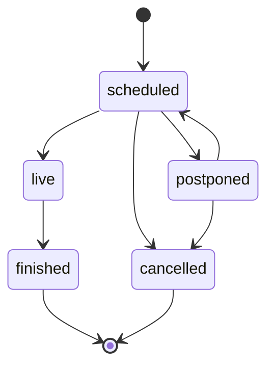

# ADR-0002: Event status lifecycle

Status: Accepted

Date: 2026-11-19

## Context

The brief says events may evolve over time and asks to model lifecycle transitions explicitly. Design v1 makes a status update conditional on "the current allowed state" but does not define the states.

## Decision

An event has one of five statuses: `scheduled`, `live`, `finished`, `postponed`, `cancelled`.

| From | To |
| ---- | -- |
| `scheduled` | `live`, `postponed`, `cancelled` |
| `postponed` | `scheduled` (requires a new start time), `cancelled` |
| `live` | `finished` |
| `finished` | none (terminal) |
| `cancelled` | none (terminal) |

- Reschedule is a separate command, not a status. The event stays `scheduled` and its start time changes. `postponed` means the new start time is not known yet.
- Transitions are triggered only by explicit commands from data producers. The service does not change status by its own clock. The live match clock is out of scope.
- Every transition and every reschedule advances the event version and requires `expectedVersion`.

## Alternatives considered

- Only `scheduled`, `live` and `finished`. Rejected: cancellation and postponement, the most common schedule changes, could not be represented.
- Add `suspended` and `abandoned` for a match interrupted during play. Rejected for this scope: it adds transitions but no new design idea. Listed as a known limitation.
- Free-form status string. Rejected: there is no place to enforce allowed transitions, and invalid states become representable.
- Derive `live` and `finished` from the clock. Rejected: real matches start late and run over, so status must come from a producer.

## Consequences

- The transition table lives in one place in the domain code. The database conditional update uses the same table.
- An illegal transition is a typed domain error and maps to a conflict response. The exact API mapping is open question 9. The response on a stale version is open question 6.
- A `postponed` event has no confirmed start time. The type model and the list queries by time window must handle this (open questions 3 and 7).
- Terminal states are immutable for status. Corrections to a finished event are out of scope.
- Known limitation: a match interrupted during play cannot be represented.
