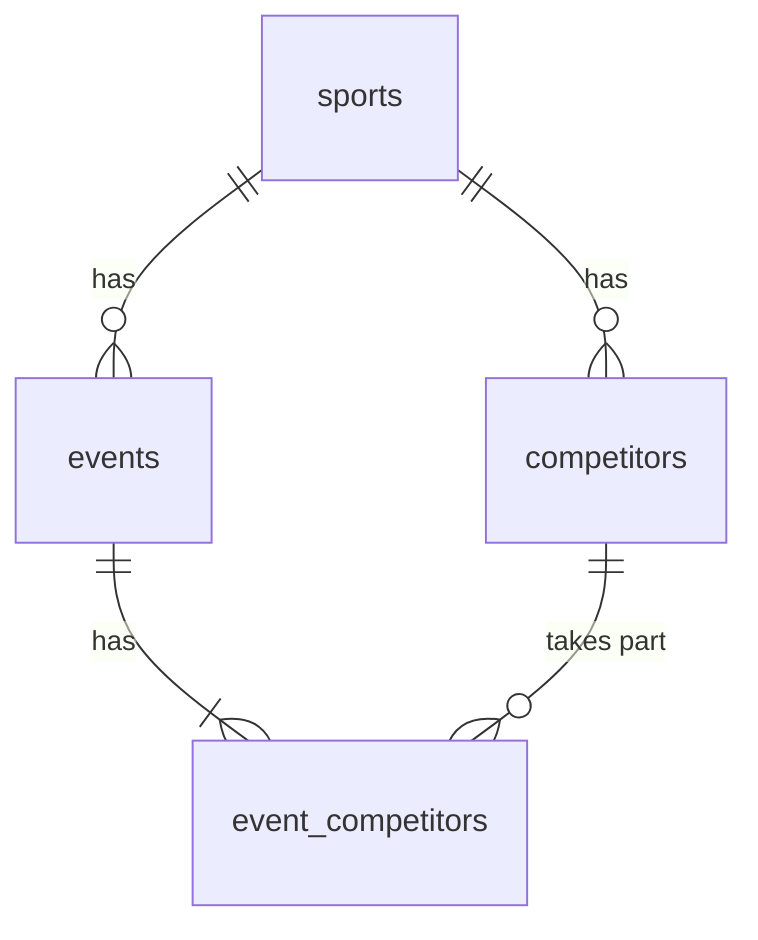

# ADR-0003: Sports, competitors and event participation

Status: Accepted

Date: 2026-11-19

## Context

Design v1 named Match and Team without fields. The brief asks to anticipate additional sports. Not every sport has two teams: tennis has two individuals, and a race has many individual participants.

Public sports data APIs were reviewed for a common shape: Sportradar ([Soccer sport event summary](https://developer.sportradar.com/soccer/reference/soccer-sport-event-summary), [UOF sport_event](https://docs.sportradar.com/uof/api-and-structure/api/elements/less-than-sport_event-greater-than)), [SportsDataIO Global API](https://sportsdata.io/developers/workflow-guide/global), [Sportmonks v3](https://docs.sportmonks.com/v3/tutorials-and-guides/tutorials/api-structure-and-navigation), the undocumented ESPN site API as described by third parties, and [IPTC Sport Schema](https://github.com/iptc/sport-schema). They share one pattern: a sport-independent event core, the sport as a referenced entity, and participants as a list with a home/away marker. These are public API shapes, not internal database schemas.

## Decision

The model has four tables.

| Table | Holds | One row is |
| ----- | ----- | ---------- |
| `sports` | the list of sports | Football |
| `competitors` | teams and individual athletes | Salzburg |
| `events` | when an event takes place and its status | the match on 2025-07-18 18:30 |
| `event_competitors` | who takes part in which event, and in which role | Salzburg takes part in that match as home |

- A sport is identified by a stable code (for example `football`, `ice_hockey`). The display name can change. Adding a sport is a data change, not a release.
- The entity is named Competitor, not Team: it is a team or an individual. A competitor belongs to exactly one sport.
- The role column holds `home` or `away` for two-sided matches. Sportradar's API calls this marker `qualifier`.

Example for the brief's event "2025-07-18 18:30 - Football - Salzburg vs. Sturm". The IDs are placeholders; the ID format is open question 4.

`sports`

| code | name |
| ---- | ---- |
| football | Football |

`competitors`

| id | sport | name |
| -- | ----- | ---- |
| C1 | football | Salzburg |
| C2 | football | Sturm |

`events`

| id | sport | starts at | status |
| -- | ----- | --------- | ------ |
| E1 | football | 2025-07-18 18:30 | scheduled |

`event_competitors`

| event | competitor | role |
| ----- | ---------- | ---- |
| E1 | C1 | home |
| E1 | C2 | away |

Constraints:

- An event cannot list the same competitor twice (unique on event and competitor).
- An event cannot have two home or two away competitors (unique on event and role).
- A competitor must belong to the same sport as the event.

Implemented scope: two-sided matches with one home and one away competitor. Events with more than two competitors (races, heats) fit the schema but are not implemented.

## Alternatives considered

- Two columns on the event (`home_competitor_id`, `away_competitor_id`), no link table. Simpler: one row per match, one insert, and the database guarantees exactly two competitors. Rejected: it cannot represent an event with more than two competitors, which blocks individual and multi-participant sports.
- Competitor names as text on the event. Rejected: no stable identity, "all events of a competitor" needs text matching, and spelling variants create duplicates.
- Sports as a closed union in code only. Rejected: 60 to 90 sports would mean a release for each new sport.
- A separate events table per sport. Rejected: a list of all events in a time window would need a union over every table.

## Consequences

- Reading an event with its competitors needs a join. List queries must avoid N+1 reads (open question 7).
- Creating a match writes three rows in one transaction.
- "Exactly two competitors with one home and one away" is enforced by application code inside the create transaction, not by a single database constraint. This is a known compromise of the link table.
- "All events of a competitor" is a lookup on one indexed column.
- Sport-specific data is not decided here. It remains the second part of open question 3.
