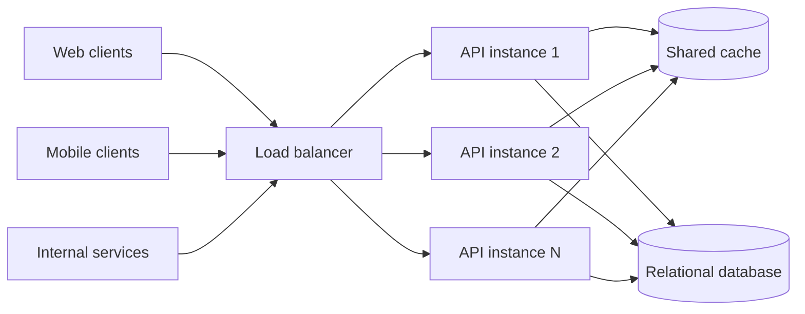
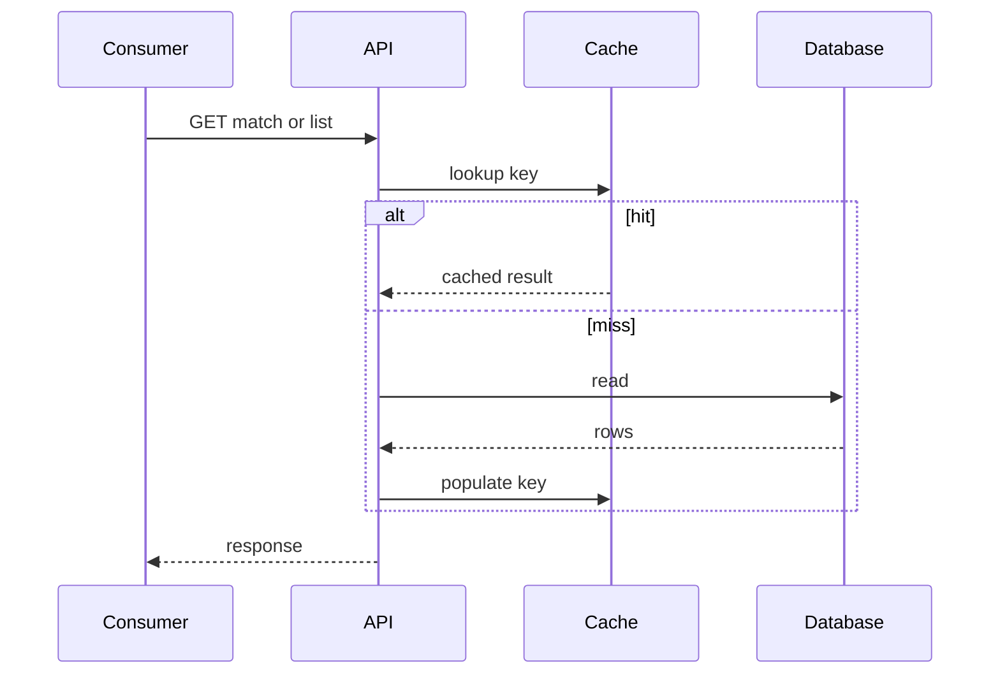
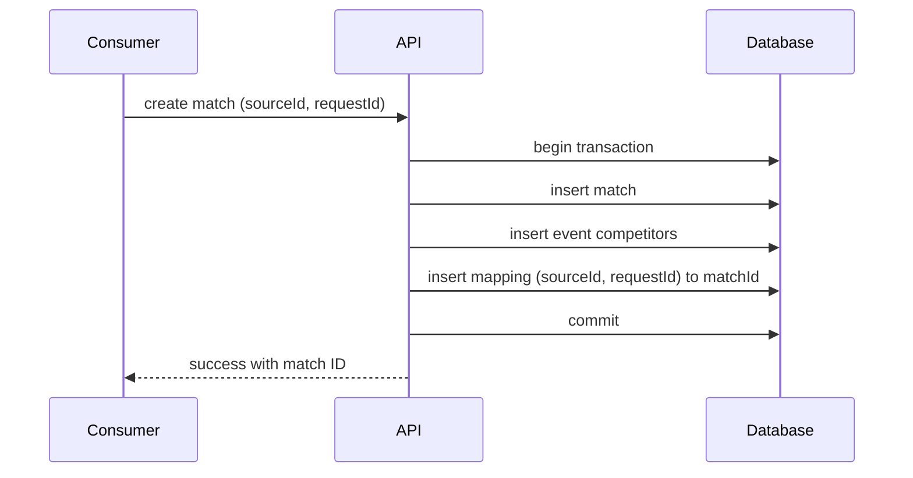
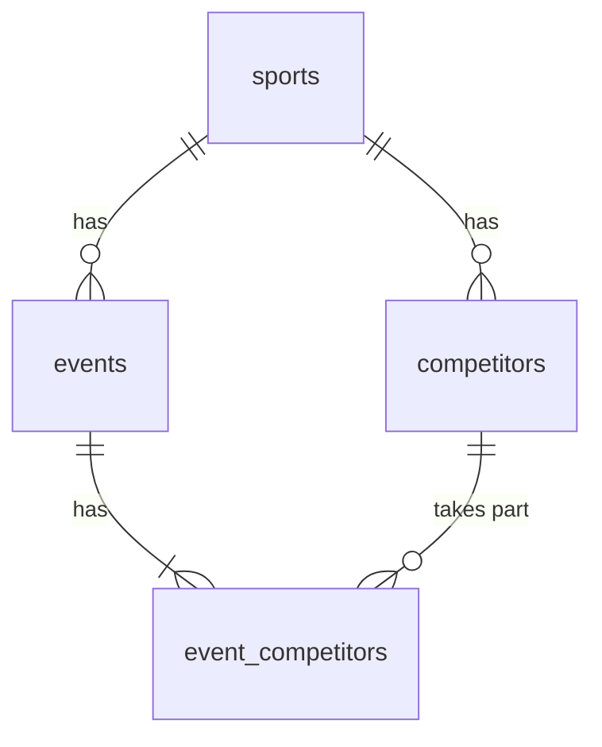
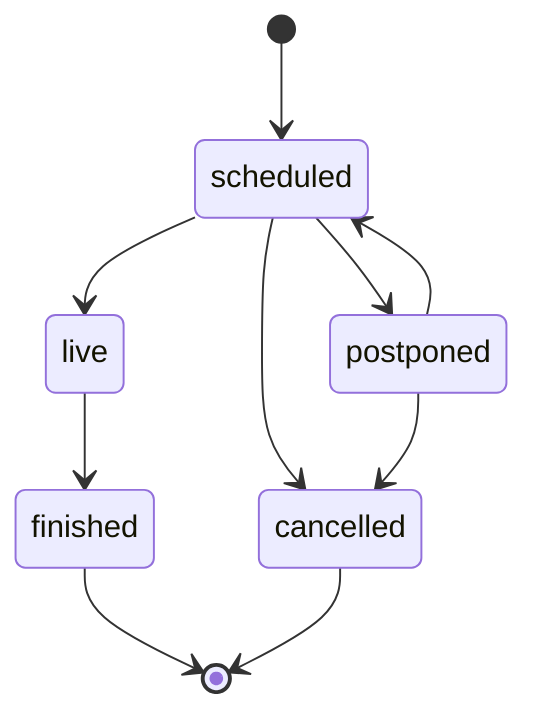

# System Design

Version 1 plus accepted decisions: [ADR-0001](adr/0001-load-assumptions.md), [ADR-0002](adr/0002-event-lifecycle.md), [ADR-0003](adr/0003-sports-and-competitors.md). Incomplete by intent; see Open questions.

## Scope of this version

- Match schedules and match statuses.
- Operations: create, read, list and update.
- The live match clock is out of scope.

## Components

- Consumers: web, mobile and internal services that read and change matches.
- Load balancer: spreads requests across the API instances.
- API service: one service, run as several identical instances.
- Shared cache: holds read results for all instances.
- Relational database: the source of truth for matches.

## Request flows

### Read / list

1. The API receives a read or list request.
2. The API checks the shared cache first.
3. On a miss, the API reads from the database and populates the cache.
4. The list cache key contains the filters and the page.
5. The cache TTL is 60 seconds. This value is tentative.

### Create

1. The API receives a create request with `sourceId` and `requestId`.
2. One database transaction persists the event, its two competitor links and the mapping `(sourceId, requestId) -> matchId`.
3. A retry with the same identity returns the stored match ID.
4. The API returns success after the commit.

### Status update

1. The API receives a status update with `expectedVersion`.
2. The write is conditional on a transition allowed by the [event lifecycle](#event-lifecycle) and on `expectedVersion`.
3. On success, the version advances.

### Failure modes

1. Cache outage: each API instance reuses the in-flight promise for the same key.
2. Cache outage: each API instance caps database concurrency.
3. Database outage: the service serves only fresh cached reads.
4. Database outage: the service refuses writes.

## Load and volume assumptions

The numbers and their basis are in [ADR-0001](adr/0001-load-assumptions.md).

| Parameter | Value |
| --------- | ----- |
| New events per year | 400,000 to 1,000,000; sized for 1,000,000 |
| New events per day | about 2,700 on average, up to 10,000 on a peak day |
| Rows after 5 years | about 5 million |
| Writes per event over its life | 5 to 10 (create, reschedule, start, finish, corrections) |
| Write rate, average | below 1 per second |
| Write rate, peak | 50 to 100 per second |
| Read rate, average | 2,400 requests per second |
| Read rate, peak | 10,000 to 12,000 requests per second |
| Acceptable staleness, lists | up to 60 seconds |
| Acceptable staleness, single event | up to 5 seconds |

Average case:

- 24,000 viewers poll every 10 seconds. That is 2,400 requests per second on average.
- A 90% cache hit rate leaves 240 database reads per second.
- At 100 ms per read, about 24 reads are in flight on average, if the database keeps up.
- Connection-pool wait time and actual completions are separate measurements.

Peak case:

- 12,000 requests per second with a 90% cache hit rate leaves 1,200 database reads per second.
- At 100 ms per read, about 120 reads are in flight.
- This exceeds a small connection pool. Open question 8 must address it.

## Entities

The model is defined in [ADR-0003](adr/0003-sports-and-competitors.md).

| Table | Holds | One row is |
| ----- | ----- | ---------- |
| `sports` | the list of sports | Football |
| `competitors` | teams and individual athletes | Salzburg |
| `events` | when an event takes place and its status | the match on 2025-07-18 18:30 |
| `event_competitors` | who takes part in which event, and in which role | Salzburg takes part in that match as home |

- A competitor is a team or an individual athlete.
- The implemented scope is two-sided matches with one home and one away competitor.

## Event lifecycle

The statuses and transitions are defined in [ADR-0002](adr/0002-event-lifecycle.md).

- Reschedule is a command, not a status. The event stays `scheduled` and its start time changes.
- Transitions come only from producer commands. The service does not change status by its own clock.
- Every change advances the version.

## Open questions

| #  | Question                                                                                                  | Why it matters |
| -- | --------------------------------------------------------------------------------------------------------- | -------------- |
| 1  | Closed by [ADR-0001](adr/0001-load-assumptions.md). ~~Load assumptions: are viewer count, polling interval and read/write ratio the right basis?~~ | The load estimate drives cache, pool and capacity choices. |
| 2  | Closed by [ADR-0002](adr/0002-event-lifecycle.md). ~~Domain model: exact status set, allowed transitions, terminal states.~~ | Conditional status updates need a defined set of allowed states. |
| 3  | Partly closed by [ADR-0003](adr/0003-sports-and-competitors.md). ~~Is Team a separate entity with its own identity? How are sports represented?~~ Still open: how sport-specific data are represented. | It shapes the schema and the type model. |
| 4  | Time model (UTC instant only vs. plus venue time zone) and ID strategy.                                   | Schedules and list windows depend on how time and identity are stored. |
| 5  | Create: what `sourceId` is, and what counts as a duplicate match beyond a retried request.               | A retry is covered by the request identity; other duplicates are not. |
| 6  | Update: response on a stale `expectedVersion`; updates other than status (for example reschedule).        | Defines the conflict behavior and the set of write operations. |
| 7  | List queries: which filters are supported, pagination style (v1 uses a page number), which indexes back them. | Filters and paging decide cache keys and database load. |
| 8  | Cache: final TTL, invalidation after writes, what "fresh" means during a database outage.                 | These rules set how stale a reader can see data. |
| 9  | API style and error format.                                                                               | Consumers depend on a stable contract. |
| 10 | Tooling: database, query layer, HTTP framework, test tools.                                               | Each tool choice must be justified. |
| 11 | How consumers learn about changes (polling only vs. published change events).                             | It changes the load estimate and the write path. |
| 12 | Implementation boundary: which parts are code, which are extension points, which are described only.      | It sets the scope of the work. |

Each question is closed by its own commit that adds a decision record under `docs/adr/` and updates this document.
