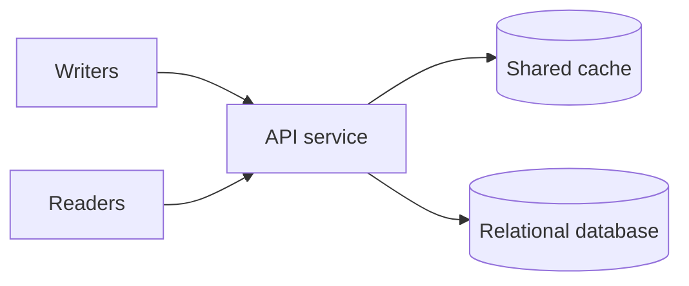
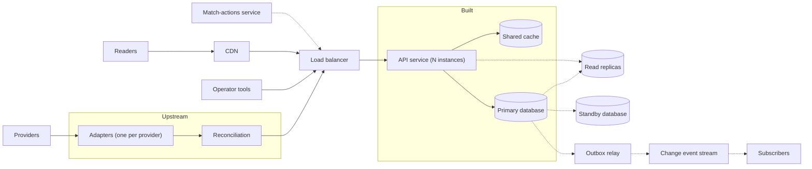
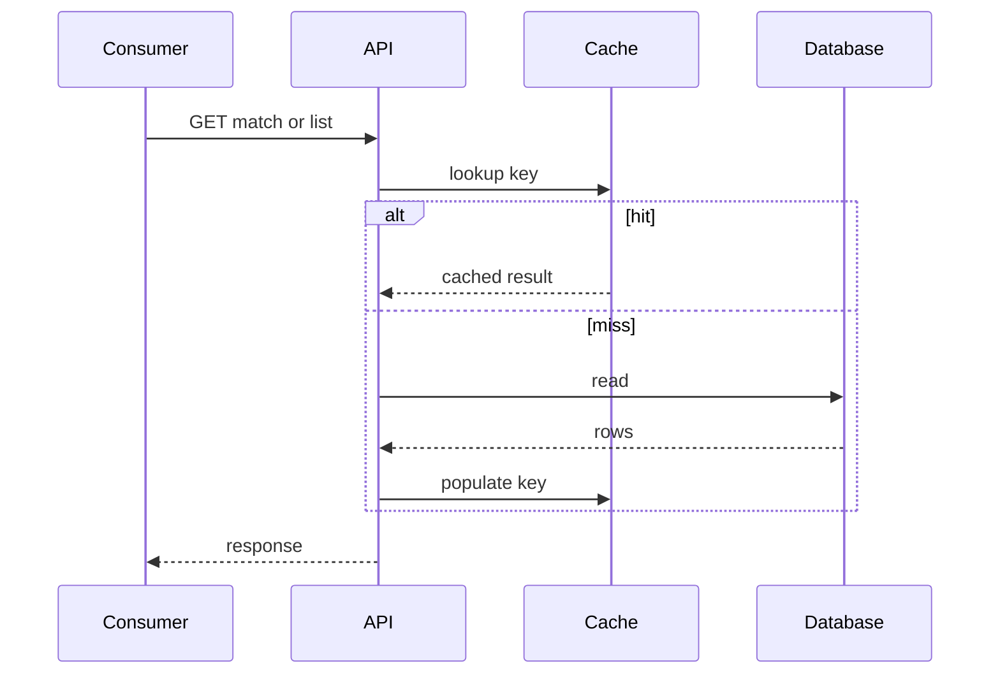
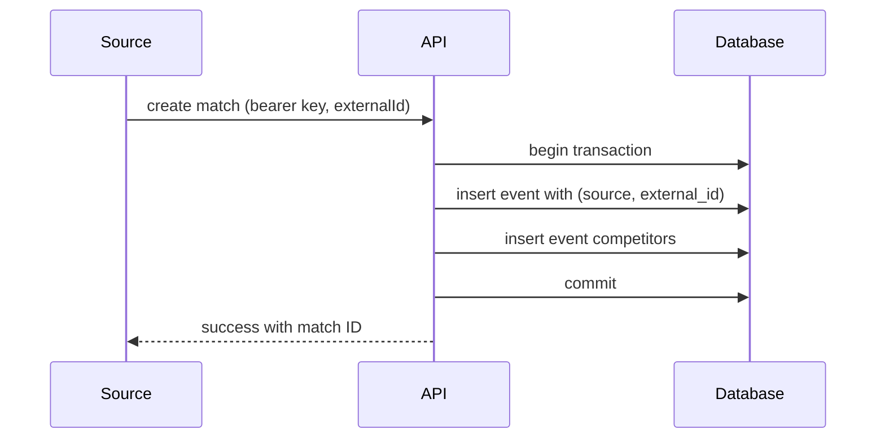
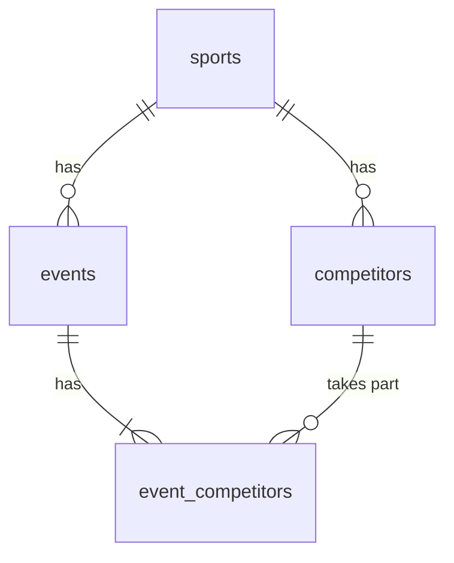
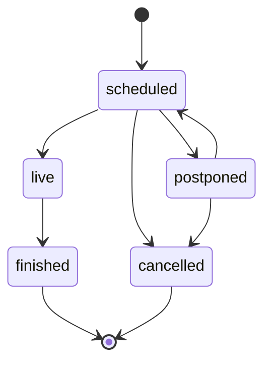

# System Design

Version 1 plus accepted decisions: [ADR-0001](adr/0001-load-assumptions.md), [ADR-0002](adr/0002-event-lifecycle.md), [ADR-0003](adr/0003-sports-and-competitors.md), [ADR-0004](adr/0004-sport-specific-phase.md), [ADR-0005](adr/0005-time-in-utc.md), [ADR-0006](adr/0006-identifiers.md), [ADR-0007](adr/0007-source-identity.md), [ADR-0008](adr/0008-ingestion-boundary.md), [ADR-0009](adr/0009-optimistic-concurrency.md), [ADR-0010](adr/0010-write-commands.md), [ADR-0011](adr/0011-read-queries.md), [ADR-0012](adr/0012-cursor-pagination.md), [ADR-0013](adr/0013-indexes.md), [ADR-0014](adr/0014-cache-freshness.md), [ADR-0015](adr/0015-shared-cache.md), [ADR-0016](adr/0016-failure-modes.md), [ADR-0017](adr/0017-rest-api.md), [ADR-0018](adr/0018-error-format.md), [ADR-0019](adr/0019-response-shape.md), [ADR-0020](adr/0020-change-propagation.md), [ADR-0021](adr/0021-implementation-boundary.md), [ADR-0022](adr/0022-postgresql.md), [ADR-0023](adr/0023-kysely.md), [ADR-0024](adr/0024-fastify.md), [ADR-0025](adr/0025-zod.md), [ADR-0026](adr/0026-test-tools.md), [ADR-0027](adr/0027-names-in-event-responses.md), [ADR-0028](adr/0028-source-ownership-needs-authentication.md) (superseded by ADR-0042), [ADR-0029](adr/0029-list-page-size-parameter.md), [ADR-0030](adr/0030-domain-decides-commands.md), [ADR-0031](adr/0031-phase-checked-at-run-time.md), [ADR-0032](adr/0032-duplicate-guard-not-built.md), [ADR-0033](adr/0033-branded-types-for-identifiers-only.md), [ADR-0034](adr/0034-validation-boundaries.md), [ADR-0035](adr/0035-same-sport-enforced-by-schema.md), [ADR-0036](adr/0036-current-state-only.md), [ADR-0037](adr/0037-refusals-of-well-formed-input.md), [ADR-0038](adr/0038-repeated-create-returns-stored-event.md), [ADR-0039](adr/0039-revalidation-and-weak-etags.md), [ADR-0040](adr/0040-time-limits-and-retry-after.md), [ADR-0041](adr/0041-time-window-bounds.md), [ADR-0042](adr/0042-writer-authentication.md), [ADR-0043](adr/0043-local-fallback-cache.md). All open questions of version 1 are closed.

## Scope of this version

- Match schedules and match statuses.
- Operations: create, read, list, and six named write commands ([ADR-0010](adr/0010-write-commands.md)).
- The live match clock is out of scope.
- Match actions (goals, cards, substitutions), score and statistics are out of scope. They belong to a neighbouring service.

## Components

Two diagrams separate what this repository builds from what a production setup adds ([ADR-0021](adr/0021-implementation-boundary.md)).

### What is built

- Writers: systems that create and change matches. An operator tool, or the reconciliation component upstream.
- Readers: web, mobile and internal services that read matches.
- API service: one stateless service. It can run as several identical instances.
- Shared cache: holds read results for all instances. Redis, behind a cache port ([ADR-0015](adr/0015-shared-cache.md)).
- Relational database: the source of truth for matches. PostgreSQL ([ADR-0022](adr/0022-postgresql.md)).

### Target for production

Everything outside the box "Built" is described and not built.

- Adapters: one small component per provider. Each converts the provider format into the canonical format ([ADR-0008](adr/0008-ingestion-boundary.md)).
- Reconciliation: decides whether records from different providers are the same real match, and whose data wins ([ADR-0008](adr/0008-ingestion-boundary.md)).
- CDN: serves list pages for up to 60 seconds and asks the service before each reuse of one event ([ADR-0039](adr/0039-revalidation-and-weak-etags.md)).
- Load balancer: spreads requests across the API instances.
- Read replicas: take list reads when the primary database is the limit ([ADR-0001](adr/0001-load-assumptions.md)).
- Standby database: takes over when the primary fails. The cache serves reads during the switch ([ADR-0016](adr/0016-failure-modes.md)).
- Outbox relay and change event stream: each write stores a row that describes the change in the same transaction. The relay publishes the rows to a stream ([ADR-0020](adr/0020-change-propagation.md)).
- Match-actions service: a neighbouring service for goals, cards, score and statistics. It refers to matches by the event ID of this service and reads them through the API ([ADR-0010](adr/0010-write-commands.md)).

## Request flows

### Read / list

There are two read operations ([ADR-0011](adr/0011-read-queries.md)): one event by ID, and one list.

- List filters, all optional: time window, sport, status, competitor. The time window includes its start and excludes its end ([ADR-0041](adr/0041-time-window-bounds.md)).
- List order is fixed: start time, then event ID.
- Paging uses a cursor on that order: 50 events by default, 100 at most ([ADR-0012](adr/0012-cursor-pagination.md)). The consumer chooses the size with `limit`, from 1 to 100 ([ADR-0029](adr/0029-list-page-size-parameter.md)).
- Each query has one index, and every list index ends with the list order ([ADR-0013](adr/0013-indexes.md)).

1. The API receives a read or list request.
2. The API checks the shared cache first.
3. On a miss, the API reads from the database and populates the cache.
4. The list cache key contains the filters, the cursor and the limit.
5. A list page is fresh for 60 seconds. One event is deleted from the cache when it changes, and is fresh for at most 60 seconds as a safety net ([ADR-0014](adr/0014-cache-freshness.md)). An entry older than 60 seconds stays in the cache for up to 1 hour and is served only while the database is down ([ADR-0016](adr/0016-failure-modes.md)).

### Create

1. The API receives a create request with a bearer key and `externalId`. It derives the source from the key.
2. One database transaction persists the event with its `(source, external_id)` pair and its two competitor links.
3. A repeated create with the same pair returns the stored event with status 200. A new event is answered with status 201. The data of a repeat is not compared, and a repeat never changes the event ([ADR-0038](adr/0038-repeated-create-returns-stored-event.md)).
4. The same real match sent by another source becomes a second event. The service has no duplicate guard. Preventing duplicates belongs to reconciliation upstream ([ADR-0008](adr/0008-ingestion-boundary.md), [ADR-0032](adr/0032-duplicate-guard-not-built.md)).
5. The API returns success after the commit.

### Write commands

1. The writer reads the event and learns its version.
2. The API receives one of the six commands with `expectedVersion`.
3. The API reads the event. The domain checks `expectedVersion` and the [event lifecycle](#event-lifecycle) and returns the new event or an error.
4. One statement writes the new event only if the stored version still equals `expectedVersion` ([ADR-0030](adr/0030-domain-decides-commands.md)).
5. On success, the version advances by 1. After the commit, the API deletes the cache entry of the event.
6. On a version mismatch, the API refuses the change with a conflict that carries the current version. The writer reads again and decides again.

The rule is the same for every writer, see [ADR-0009](adr/0009-optimistic-concurrency.md).

| Command | Allowed from | Resulting status |
| ------- | ------------ | ---------------- |
| start | `scheduled` | `live` |
| finish | `live` | `finished` |
| postpone | `scheduled` | `postponed` |
| reschedule | `scheduled`, `postponed` | `scheduled` |
| cancel | `scheduled`, `postponed` | `cancelled` |
| change phase | `live` | `live` |

There is no generic update operation, see [ADR-0010](adr/0010-write-commands.md).

### Failure modes

The rules are defined in [ADR-0016](adr/0016-failure-modes.md) and [ADR-0040](adr/0040-time-limits-and-retry-after.md).

| Failure | Behaviour |
| ------- | --------- |
| A popular cache entry expires | Concurrent requests for one key inside an instance share one in-flight database read. Always on. |
| The cache is down | A local cache inside each instance answers repeated reads for up to 5 seconds ([ADR-0043](adr/0043-local-fallback-cache.md)). The other reads go to the database. A fixed connection pool caps the load. A request that waits more than 200 ms for a connection is refused as overloaded. |
| The database is slow | A statement that runs longer than 1 second is cancelled by the database. The request is handled as in the next row. |
| The database is down | Cached entries up to 1 hour old are served. Their age is visible in `generatedAt` and the `Age` header. Reads without an entry and all writes are refused as unavailable. |

Every refusal with status 503 carries `Retry-After`: 1 second when overloaded, 5 seconds when unavailable. The limits and the waits are configuration.

Described, not built: a standby database with automatic failover.

## API

The API is REST over HTTP with JSON ([ADR-0017](adr/0017-rest-api.md)). GET routes are public.
POST routes require an opaque bearer key. A missing or invalid key returns 401 with a `WWW-Authenticate: Bearer` challenge.
A command on another source's event returns 403 ([ADR-0042](adr/0042-writer-authentication.md)).

| Action | Request |
| ------ | ------- |
| Create an event | `POST /events` |
| Get one event | `GET /events/{id}` |
| List events | `GET /events` with filters, cursor and limit |
| Six write commands | `POST /events/{id}/start`, `/finish`, `/postpone`, `/reschedule`, `/cancel`, `/phase` |

Every error uses one format, RFC 9457 Problem Details, with a stable `code` ([ADR-0018](adr/0018-error-format.md)). Status 400 is a wrong format, 422 is correct format with data that breaks a rule, 409 is a conflict with the stored event ([ADR-0037](adr/0037-refusals-of-well-formed-input.md)).

A success response has `generatedAt` at the top and the payload under `event` or `events`. Freshness is stated with `Cache-Control`, `ETag` and `Age`. There is no envelope and no stale flag ([ADR-0019](adr/0019-response-shape.md)). One event is sent with `no-cache`, so a cache asks the service before each reuse. A list page is sent with `max-age=60`. Every `ETag` is weak ([ADR-0039](adr/0039-revalidation-and-weak-etags.md)). An event carries the names of its sport and competitors ([ADR-0027](adr/0027-names-in-event-responses.md)).

## Load and volume assumptions

The numbers and their basis are in [ADR-0001](adr/0001-load-assumptions.md).

| Parameter | Value |
| --------- | ----- |
| New events per year | 400,000 to 1,000,000; sized for 1,000,000 |
| New events per day | about 2,700 on average, up to 10,000 on a peak day |
| Rows after 5 years | about 5 million |
| Writes per event over its life | 5 to 10 (create, reschedule, start, finish, corrections) |
| Write rate, average | below 1 per second |
| Write rate, peak | 50 to 100 per second |
| Read rate, average | 2,400 requests per second |
| Read rate, peak | 10,000 to 12,000 requests per second |
| Acceptable staleness, lists | up to 60 seconds |
| Acceptable staleness, single event | none in the normal case, up to 60 seconds after a lost cache delete ([ADR-0014](adr/0014-cache-freshness.md)) |

Average case:

- 24,000 viewers poll every 10 seconds. That is 2,400 requests per second on average.
- A 90% cache hit rate leaves 240 database reads per second.
- At 10 ms per read, two to three reads are in flight on average. The 10 ms is a cautious figure for sizing. The measured best case is 1 to 2 ms in the database: 50,000 events, one connection, all data in memory, a development machine.
- Connection-pool wait time and actual completions are separate measurements.

Peak case:

- 12,000 requests per second with a 90% cache hit rate leaves 1,200 database reads per second.
- At 10 ms per read, about 12 reads are in flight. A small connection pool covers this.
- During a cache outage without the local cache, all 12,000 requests per second would reach the database. At 10 ms that is about 120 reads in flight, more than the pool. [ADR-0016](adr/0016-failure-modes.md) caps the pool and refuses the excess. The local cache of [ADR-0043](adr/0043-local-fallback-cache.md) cuts this load to at most one read per key, per instance, per 5 seconds, for the 1,000 keys it holds.

## Entities

The model is defined in [ADR-0003](adr/0003-sports-and-competitors.md).

| Table | Holds | One row is |
| ----- | ----- | ---------- |
| `sports` | the list of sports | Football |
| `competitors` | teams and individual athletes | Salzburg |
| `events` | when an event takes place and its status | the match on 2025-07-18 18:30 |
| `event_competitors` | who takes part in which event, and in which role | Salzburg takes part in that match as home |

- A competitor is a team or an individual athlete.
- Sports and competitors are reference data loaded by seed data. The API does not create or change them. Event responses embed their names ([ADR-0027](adr/0027-names-in-event-responses.md)).
- The implemented scope is two-sided matches with one home and one away competitor.
- The database enforces with composite foreign keys that each competitor of an event belongs to the sport of the event ([ADR-0035](adr/0035-same-sport-enforced-by-schema.md)).

## Event lifecycle

The statuses and transitions are defined in [ADR-0002](adr/0002-event-lifecycle.md).

- Reschedule is a command, not a status. The event stays `scheduled` and its start time changes.
- Transitions come only from producer commands. The service does not change status by its own clock.
- Every change advances the version.
- The service stores the current state only. Actual start and end times, a cancellation reason and earlier start times are not stored ([ADR-0036](adr/0036-current-state-only.md)).

### Live phase

An event in status `live` may carry a sport-specific phase, defined in [ADR-0004](adr/0004-sport-specific-phase.md).

| Sport | Phases |
| ----- | ------ |
| football | `1st_half`, `2nd_half` |
| ice_hockey | `1st_period`, `2nd_period`, `3rd_period` |
| any other sport | no phase (always absent) |

- The phase exists only while the event is `live`.
- In code the phase is a string. The domain checks it at run time against one table of phases per sport ([ADR-0031](adr/0031-phase-checked-at-run-time.md)).
- The generic status is complete on its own. Consumers may ignore the phase.

## Time

The time model is defined in [ADR-0005](adr/0005-time-in-utc.md).

- An event start is one instant, stored as `timestamptz`.
- The API returns time only in UTC, ISO 8601 with `Z`.
- Input must carry an explicit offset or `Z`. Input without a zone is rejected.
- In code the start time is a `Date`. The HTTP layer enforces the input rule and the output format ([ADR-0033](adr/0033-branded-types-for-identifiers-only.md)).

## Identifiers

The ID strategy is defined in [ADR-0006](adr/0006-identifiers.md).

- Events and competitors have a UUID v7 generated by the service before the write.
- Sports are identified by their stable code.
- In code only the event ID and the competitor ID are branded types. Other values are plain `string`, `number` and `Date` ([ADR-0033](adr/0033-branded-types-for-identifiers-only.md)).
- Every event also stores the `source` that wrote it and that source's `external_id`. The pair is unique and makes create idempotent. See [ADR-0007](adr/0007-source-identity.md).
- The service authenticates writes with opaque bearer keys. It takes the source from the configured key hash and returns 403 for commands on another source's events. GET routes are public. See [ADR-0042](adr/0042-writer-authentication.md).

## Change propagation

Consumers poll, and conditional requests make polling cheap. Publishing change events through a transactional outbox is described, not built ([ADR-0020](adr/0020-change-propagation.md)).

## Implementation boundary

The design describes a platform. The implementation is one service. [ADR-0021](adr/0021-implementation-boundary.md) places every part in one of three categories: built, extension point, described.

Not built, in short: provider adapters, reconciliation, the exact-duplicate guard, change events, match actions, load balancer and CDN, database replicas and failover, and per-consumer rate limiting.

## Tooling

| Concern | Choice | Decision |
| ------- | ------ | -------- |
| Database | PostgreSQL | [ADR-0022](adr/0022-postgresql.md) |
| Query layer | Kysely | [ADR-0023](adr/0023-kysely.md) |
| HTTP framework | Fastify | [ADR-0024](adr/0024-fastify.md) |
| Schemas and validation of requests and configuration | Zod | [ADR-0025](adr/0025-zod.md), [ADR-0034](adr/0034-validation-boundaries.md) |
| Cache | Redis | [ADR-0015](adr/0015-shared-cache.md) |
| Tests | Vitest, Testcontainers, fast-check | [ADR-0026](adr/0026-test-tools.md) |

## Open questions

| #  | Question                                                                                                  | Why it matters |
| -- | --------------------------------------------------------------------------------------------------------- | -------------- |
| 1  | Closed by [ADR-0001](adr/0001-load-assumptions.md). ~~Load assumptions: are viewer count, polling interval and read/write ratio the right basis?~~ | The load estimate drives cache, pool and capacity choices. |
| 2  | Closed by [ADR-0002](adr/0002-event-lifecycle.md). ~~Domain model: exact status set, allowed transitions, terminal states.~~ | Conditional status updates need a defined set of allowed states. |
| 3  | Closed by [ADR-0003](adr/0003-sports-and-competitors.md) and [ADR-0004](adr/0004-sport-specific-phase.md). ~~Domain model: how sports and sport-specific data are represented; is Team a separate entity with its own identity?~~ | It shapes the schema and the type model. |
| 4  | Closed by [ADR-0005](adr/0005-time-in-utc.md) and [ADR-0006](adr/0006-identifiers.md). ~~Time model (UTC instant only vs. plus venue time zone) and ID strategy.~~ | Schedules and list windows depend on how time and identity are stored. |
| 5  | Closed by [ADR-0007](adr/0007-source-identity.md) and [ADR-0008](adr/0008-ingestion-boundary.md). ~~Create: what `sourceId` is, and what counts as a duplicate match beyond a retried request.~~ | A retry is covered by the request identity; other duplicates are not. |
| 6  | Closed by [ADR-0009](adr/0009-optimistic-concurrency.md) and [ADR-0010](adr/0010-write-commands.md). ~~Update: response on a stale `expectedVersion`; updates other than status (for example reschedule).~~ | Defines the conflict behavior and the set of write operations. |
| 7  | Closed by [ADR-0011](adr/0011-read-queries.md), [ADR-0012](adr/0012-cursor-pagination.md) and [ADR-0013](adr/0013-indexes.md). ~~List queries: which filters are supported, pagination style (v1 uses a page number), which indexes back them.~~ | Filters and paging decide cache keys and database load. |
| 8  | Closed by [ADR-0014](adr/0014-cache-freshness.md), [ADR-0015](adr/0015-shared-cache.md) and [ADR-0016](adr/0016-failure-modes.md). ~~Cache: final TTL, invalidation after writes, what "fresh" means during a database outage.~~ | These rules set how stale a reader can see data. |
| 9  | Closed by [ADR-0017](adr/0017-rest-api.md) and [ADR-0018](adr/0018-error-format.md). ~~API style and error format.~~ | Consumers depend on a stable contract. |
| 10 | Closed by [ADR-0022](adr/0022-postgresql.md), [ADR-0023](adr/0023-kysely.md), [ADR-0024](adr/0024-fastify.md), [ADR-0025](adr/0025-zod.md) and [ADR-0026](adr/0026-test-tools.md). ~~Tooling: database, query layer, HTTP framework, test tools.~~ | Each tool choice must be justified. |
| 11 | Closed by [ADR-0020](adr/0020-change-propagation.md). ~~How consumers learn about changes (polling only vs. published change events).~~ | It changes the load estimate and the write path. |
| 12 | Closed by [ADR-0021](adr/0021-implementation-boundary.md). ~~Implementation boundary: which parts are code, which are extension points, which are described only.~~ | It sets the scope of the work. |
| 13 | Closed by [ADR-0027](adr/0027-names-in-event-responses.md). ~~How a consumer gets the names of the sport and the competitors, and how that reference data is created.~~ | A consumer cannot show "Salzburg vs. Sturm" from IDs alone. |
| 14 | Closed by [ADR-0042](adr/0042-writer-authentication.md). ~~Who may change an event: how the rule "a source changes only its own events" is enforced.~~ | A bearer key identifies the source. Commands require ownership. |
| 15 | Closed by [ADR-0029](adr/0029-list-page-size-parameter.md). ~~How a consumer chooses the page size of the list, and what happens to the cache key.~~ | The maximum of ADR-0012 is unusable without a parameter, and the cache key must tell page sizes apart. |
| 16 | Closed by [ADR-0030](adr/0030-domain-decides-commands.md). ~~Where the lifecycle rules run: in the conditional SQL statement, in the domain, or in both.~~ | Rules written twice can drift apart. |
| 17 | Closed by [ADR-0031](adr/0031-phase-checked-at-run-time.md). ~~How the phase is typed in code when sports are data: a union per sport or a string with a run-time check.~~ | Types per sport made the domain hard to read without removing the run-time check. |
| 18 | Closed by [ADR-0032](adr/0032-duplicate-guard-not-built.md). ~~Whether the interim exact-duplicate guard is worth its cost in the schema and in the create path.~~ | It added a column, an index, a second conflict and a race, and caught exact copies only. |
| 19 | Closed by [ADR-0033](adr/0033-branded-types-for-identifiers-only.md). ~~Which values get a branded type of their own, and where the format of the others is checked.~~ | Seven branded values cost constructors, conversions and tests without a matching risk. |
| 20 | Closed by [ADR-0034](adr/0034-validation-boundaries.md). ~~Whether rows read from the database are validated with Zod, with the domain constructors, or with both.~~ | The first implementation checked every row twice. |

Each question was closed by its own commit that added a decision record under `docs/adr/` and updated this document. New questions found during implementation are added here and closed the same way.
