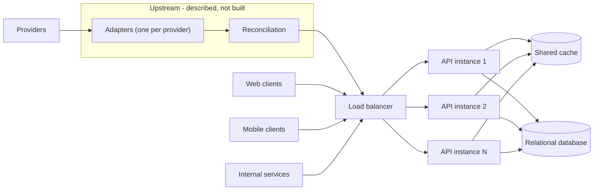
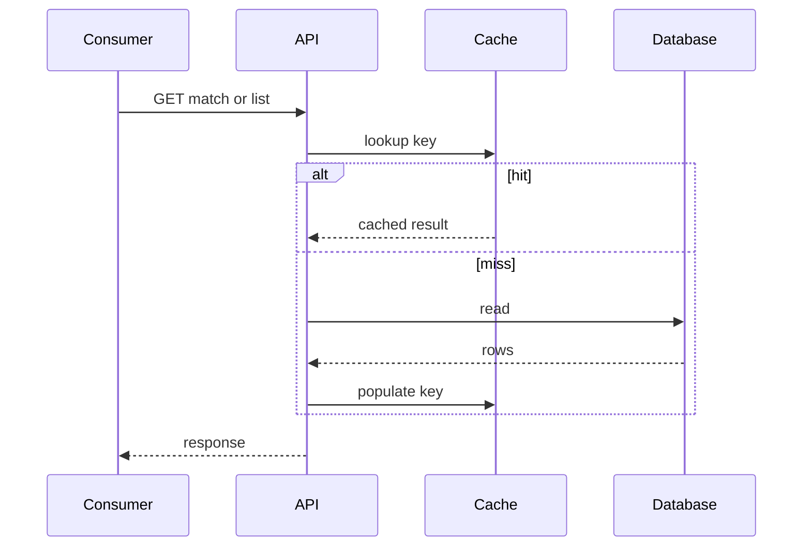
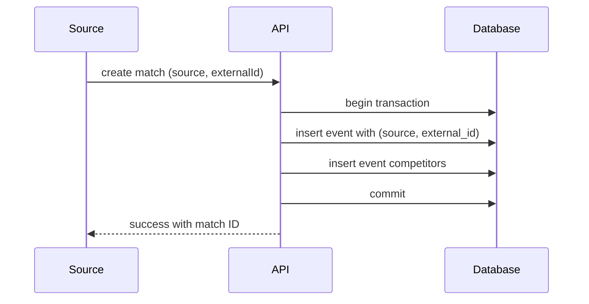
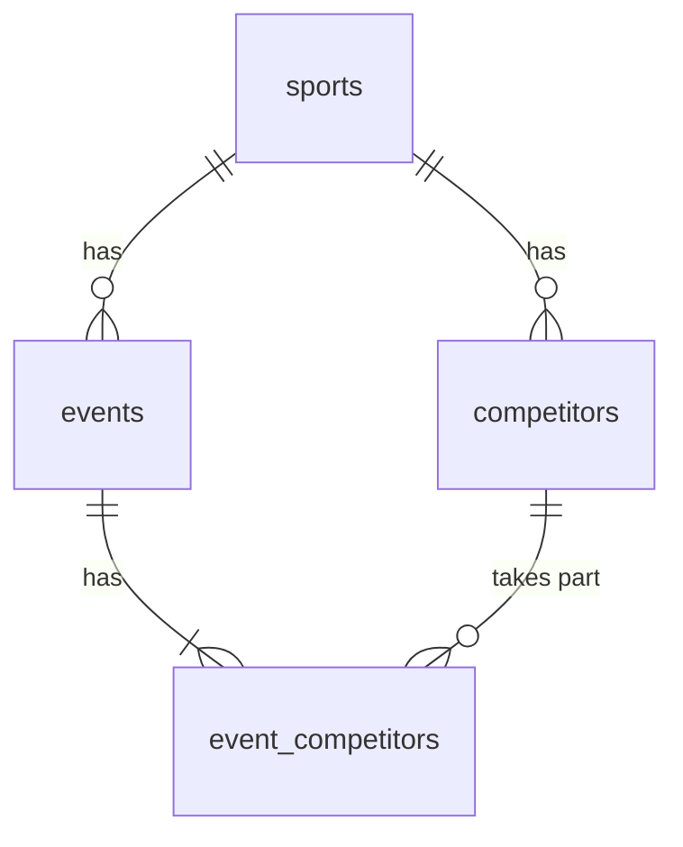
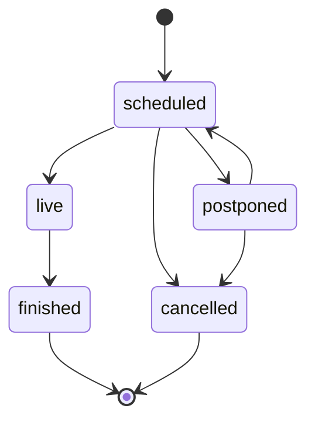

# System Design

Version 1 plus accepted decisions: [ADR-0001](adr/0001-load-assumptions.md), [ADR-0002](adr/0002-event-lifecycle.md), [ADR-0003](adr/0003-sports-and-competitors.md), [ADR-0004](adr/0004-sport-specific-phase.md), [ADR-0005](adr/0005-time-in-utc.md), [ADR-0006](adr/0006-identifiers.md), [ADR-0007](adr/0007-source-identity.md), [ADR-0008](adr/0008-ingestion-boundary.md), [ADR-0009](adr/0009-optimistic-concurrency.md), [ADR-0010](adr/0010-write-commands.md), [ADR-0011](adr/0011-read-queries.md), [ADR-0012](adr/0012-cursor-pagination.md), [ADR-0013](adr/0013-indexes.md), [ADR-0014](adr/0014-cache-freshness.md), [ADR-0015](adr/0015-shared-cache.md), [ADR-0016](adr/0016-failure-modes.md). Incomplete by intent; see Open questions.

## Scope of this version

- Match schedules and match statuses.
- Operations: create, read, list, and six named write commands ([ADR-0010](adr/0010-write-commands.md)).
- The live match clock is out of scope.
- Match actions (goals, cards, substitutions), score and statistics are out of scope. They belong to a neighbouring service.

## Components

- Consumers: web, mobile and internal services that read and change matches.
- Adapters: one small component per provider. Each converts the provider format into the canonical format. Described, not built.
- Reconciliation: decides whether records from different providers are the same real match, and whose data wins. Described, not built.
- Load balancer: spreads requests across the API instances.
- API service: one service, run as several identical instances.
- Shared cache: holds read results for all instances. Redis, behind a cache port ([ADR-0015](adr/0015-shared-cache.md)).
- Relational database: the source of truth for matches.

## Request flows

### Read / list

There are two read operations ([ADR-0011](adr/0011-read-queries.md)): one event by ID, and one list.

- List filters, all optional: time window, sport, status, competitor.
- List order is fixed: start time, then event ID.
- Paging uses a cursor on that order: 50 events by default, 100 at most ([ADR-0012](adr/0012-cursor-pagination.md)).
- Each query has one index, and every list index ends with the list order ([ADR-0013](adr/0013-indexes.md)).

1. The API receives a read or list request.
2. The API checks the shared cache first.
3. On a miss, the API reads from the database and populates the cache.
4. The list cache key contains the filters and the cursor.
5. A list page expires after 60 seconds. One event is deleted from the cache when it changes, with a 60-second expiry as a safety net ([ADR-0014](adr/0014-cache-freshness.md)).

### Create

1. The API receives a create request with `source` and `externalId`.
2. One database transaction persists the event with its `(source, external_id)` pair and its two competitor links.
3. A repeated create with the same pair returns the stored event.
4. Before the commit, the database rejects an exact duplicate: same sport, competitors and start instant from another source. The API answers with a conflict naming the existing event. This is an interim guard, see [ADR-0008](adr/0008-ingestion-boundary.md).
5. The API returns success after the commit.

### Write commands

1. The writer reads the event and learns its version.
2. The API receives one of the six commands with `expectedVersion`.
3. One conditional statement applies the write only if the transition is allowed by the [event lifecycle](#event-lifecycle) and `expectedVersion` equals the stored version.
4. On success, the version advances by 1. After the commit, the API deletes the cache entry of the event.
5. On a version mismatch, the API refuses the change with a conflict that carries the current version. The writer reads again and decides again.

The rule is the same for every writer, see [ADR-0009](adr/0009-optimistic-concurrency.md).

| Command | Allowed from | Resulting status |
| ------- | ------------ | ---------------- |
| start | `scheduled` | `live` |
| finish | `live` | `finished` |
| postpone | `scheduled` | `postponed` |
| reschedule | `scheduled`, `postponed` | `scheduled` |
| cancel | `scheduled`, `postponed` | `cancelled` |
| change phase | `live` | `live` |

There is no generic update operation, see [ADR-0010](adr/0010-write-commands.md).

### Failure modes

The rules are defined in [ADR-0016](adr/0016-failure-modes.md).

| Failure | Behaviour |
| ------- | --------- |
| A popular cache entry expires | Concurrent requests for one key inside an instance share one in-flight database read. Always on. |
| The cache is down | Reads go to the database. A fixed connection pool with a short wait caps the load; excess requests are refused as overloaded. |
| The database is down | Cached entries up to 1 hour old are served, marked as possibly stale when older than 60 seconds. Reads without an entry and all writes are refused as unavailable. |

Described, not built: a cache of a few seconds inside each instance for a shared-cache outage, and a standby database with automatic failover.

## Load and volume assumptions

The numbers and their basis are in [ADR-0001](adr/0001-load-assumptions.md).

| Parameter | Value |
| --------- | ----- |
| New events per year | 400,000 to 1,000,000; sized for 1,000,000 |
| New events per day | about 2,700 on average, up to 10,000 on a peak day |
| Rows after 5 years | about 5 million |
| Writes per event over its life | 5 to 10 (create, reschedule, start, finish, corrections) |
| Write rate, average | below 1 per second |
| Write rate, peak | 50 to 100 per second |
| Read rate, average | 2,400 requests per second |
| Read rate, peak | 10,000 to 12,000 requests per second |
| Acceptable staleness, lists | up to 60 seconds |
| Acceptable staleness, single event | none in the normal case, up to 60 seconds after a lost cache delete ([ADR-0014](adr/0014-cache-freshness.md)) |

Average case:

- 24,000 viewers poll every 10 seconds. That is 2,400 requests per second on average.
- A 90% cache hit rate leaves 240 database reads per second.
- At 100 ms per read, about 24 reads are in flight on average, if the database keeps up.
- Connection-pool wait time and actual completions are separate measurements.

Peak case:

- 12,000 requests per second with a 90% cache hit rate leaves 1,200 database reads per second.
- At 100 ms per read, about 120 reads are in flight.
- This exceeds a small connection pool. Open question 8 must address it.

## Entities

The model is defined in [ADR-0003](adr/0003-sports-and-competitors.md).

| Table | Holds | One row is |
| ----- | ----- | ---------- |
| `sports` | the list of sports | Football |
| `competitors` | teams and individual athletes | Salzburg |
| `events` | when an event takes place and its status | the match on 2025-07-18 18:30 |
| `event_competitors` | who takes part in which event, and in which role | Salzburg takes part in that match as home |

- A competitor is a team or an individual athlete.
- The implemented scope is two-sided matches with one home and one away competitor.

## Event lifecycle

The statuses and transitions are defined in [ADR-0002](adr/0002-event-lifecycle.md).

- Reschedule is a command, not a status. The event stays `scheduled` and its start time changes.
- Transitions come only from producer commands. The service does not change status by its own clock.
- Every change advances the version.

### Live phase

An event in status `live` may carry a sport-specific phase, defined in [ADR-0004](adr/0004-sport-specific-phase.md).

| Sport | Phases |
| ----- | ------ |
| football | `1st_half`, `2nd_half` |
| ice_hockey | `1st_period`, `2nd_period`, `3rd_period` |
| any other sport | no phase (always absent) |

- The phase exists only while the event is `live`.
- The generic status is complete on its own. Consumers may ignore the phase.

## Time

The time model is defined in [ADR-0005](adr/0005-time-in-utc.md).

- An event start is one instant, stored as `timestamptz`.
- The API returns time only in UTC, ISO 8601 with `Z`.
- Input must carry an explicit offset or `Z`. Input without a zone is rejected.

## Identifiers

The ID strategy is defined in [ADR-0006](adr/0006-identifiers.md).

- Events and competitors have a UUID v7 generated by the service before the write.
- Sports are identified by their stable code.
- Every event also stores the `source` that wrote it and that source's `external_id`. The pair is unique and makes create idempotent. See [ADR-0007](adr/0007-source-identity.md).

## Open questions

| #  | Question                                                                                                  | Why it matters |
| -- | --------------------------------------------------------------------------------------------------------- | -------------- |
| 1  | Closed by [ADR-0001](adr/0001-load-assumptions.md). ~~Load assumptions: are viewer count, polling interval and read/write ratio the right basis?~~ | The load estimate drives cache, pool and capacity choices. |
| 2  | Closed by [ADR-0002](adr/0002-event-lifecycle.md). ~~Domain model: exact status set, allowed transitions, terminal states.~~ | Conditional status updates need a defined set of allowed states. |
| 3  | Closed by [ADR-0003](adr/0003-sports-and-competitors.md) and [ADR-0004](adr/0004-sport-specific-phase.md). ~~Domain model: how sports and sport-specific data are represented; is Team a separate entity with its own identity?~~ | It shapes the schema and the type model. |
| 4  | Closed by [ADR-0005](adr/0005-time-in-utc.md) and [ADR-0006](adr/0006-identifiers.md). ~~Time model (UTC instant only vs. plus venue time zone) and ID strategy.~~ | Schedules and list windows depend on how time and identity are stored. |
| 5  | Closed by [ADR-0007](adr/0007-source-identity.md) and [ADR-0008](adr/0008-ingestion-boundary.md). ~~Create: what `sourceId` is, and what counts as a duplicate match beyond a retried request.~~ | A retry is covered by the request identity; other duplicates are not. |
| 6  | Closed by [ADR-0009](adr/0009-optimistic-concurrency.md) and [ADR-0010](adr/0010-write-commands.md). ~~Update: response on a stale `expectedVersion`; updates other than status (for example reschedule).~~ | Defines the conflict behavior and the set of write operations. |
| 7  | Closed by [ADR-0011](adr/0011-read-queries.md), [ADR-0012](adr/0012-cursor-pagination.md) and [ADR-0013](adr/0013-indexes.md). ~~List queries: which filters are supported, pagination style (v1 uses a page number), which indexes back them.~~ | Filters and paging decide cache keys and database load. |
| 8  | Closed by [ADR-0014](adr/0014-cache-freshness.md), [ADR-0015](adr/0015-shared-cache.md) and [ADR-0016](adr/0016-failure-modes.md). ~~Cache: final TTL, invalidation after writes, what "fresh" means during a database outage.~~ | These rules set how stale a reader can see data. |
| 9  | API style and error format.                                                                               | Consumers depend on a stable contract. |
| 10 | Tooling: database, query layer, HTTP framework, test tools.                                               | Each tool choice must be justified. |
| 11 | How consumers learn about changes (polling only vs. published change events).                             | It changes the load estimate and the write path. |
| 12 | Partly answered by [ADR-0008](adr/0008-ingestion-boundary.md) for adapters and reconciliation. Implementation boundary: which parts are code, which are extension points, which are described only.      | It sets the scope of the work. |

Each question is closed by its own commit that adds a decision record under `docs/adr/` and updates this document.
